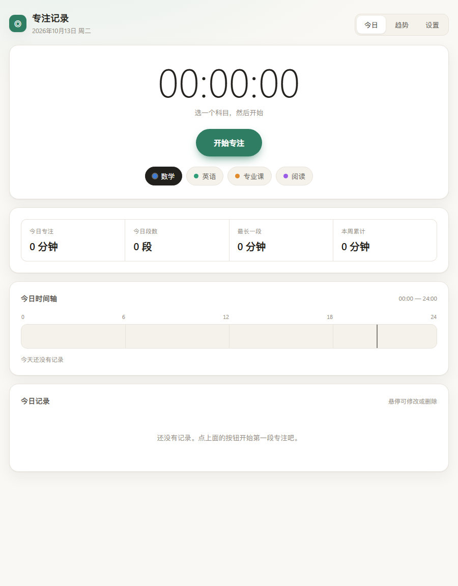
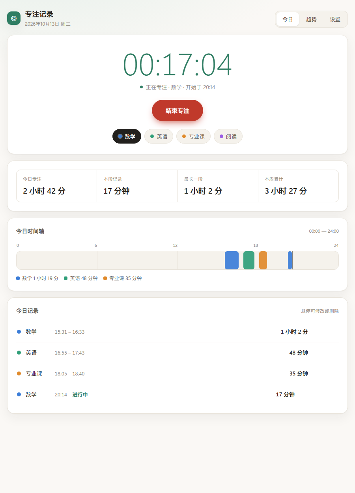
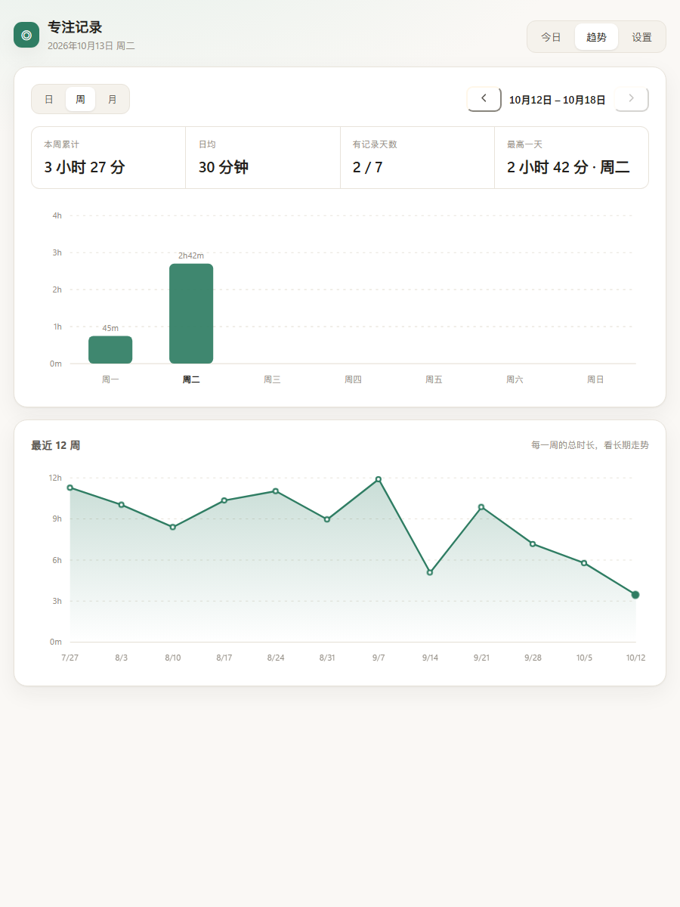
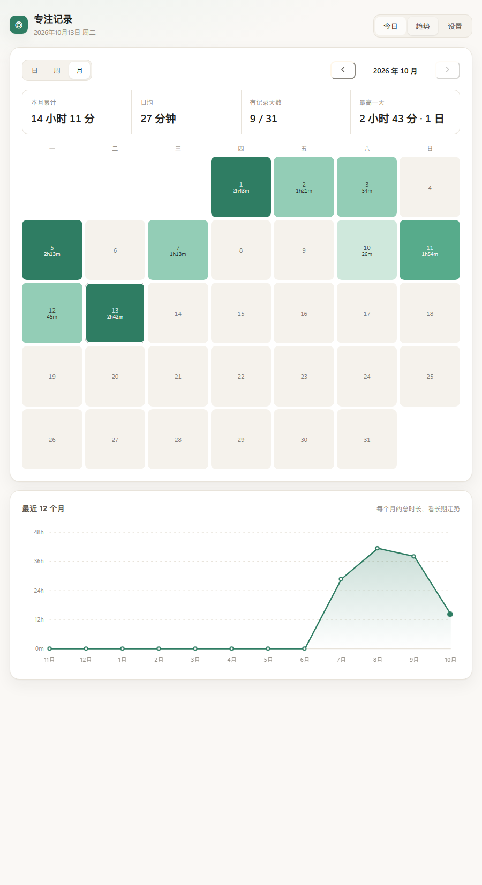
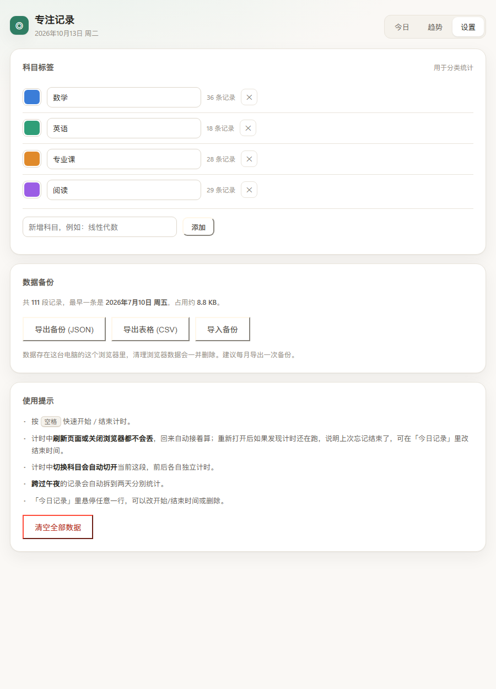

# 专注记录

一个用来记录每天学习专注时长的小工具。点一下开始，再点一下结束，一天下来能看到自己在哪些时间段学了、一共学了多久，也能看到过去每天的变化曲线。

**打开方式：双击 `index.html`** —— 不需要安装任何东西，不需要联网，不需要启动服务。



---

## 怎么用

1. 双击 `index.html`，浏览器打开就是主界面。
2. 选一个科目（数学 / 英语 / 专业课 / 阅读，可以自己改）。
3. 点 **开始专注**；学完了再点一次 **结束专注**，这段就记下来了。
4. 按 `空格` 也可以快速开始 / 结束。

上方的计时器实时走秒，浏览器标签页标题也会同步显示，切到别的标签干活时瞄一眼就知道现在计了多久。

### 今日



- 四个数字：今天一共专注多久、这一段已进行多久、最长的一段、本周累计。
- **时间轴**：一条 0–24 点的横条，用不同颜色标出今天每一段是什么时候学的，细竖线是当前时间。
- **今日记录**：今天每一段的科目、起止时间和时长。鼠标移上去，可以改开始/结束时间，也可以删掉记错的那条。

### 趋势



顶部切换 **日 / 周 / 月**：

| 视图 | 主图 | 下方 |
|---|---|---|
| 日 | 近 14 天的每日时长折线 | 近 14 天各科目时间占比 |
| 周 | 本周一到周日的柱状图（可翻页看其它周） | 近 12 周的时长曲线 |
| 月 | 当月日历热力图，颜色越深学得越久（可翻月） | 近 12 个月的时长曲线 |



把鼠标移到图上的点或柱子上，会显示那一天的准确时长。

### 设置



- **科目标签**：增删改、换颜色。删掉某个科目时，它名下的记录不会丢，会变成「未分类」。
- **数据备份**：导出 JSON（完整备份，可再导入）、导出 CSV（用 Excel 打开做表格）、导入备份。

---

## 几个不用担心的细节

- **刷新或关掉浏览器不会丢**。计时中的那一段会一直保留，回来打开还在接着算。
- **忘记点结束了**。计时超过 8 小时，页面顶部会自动弹一条橙色提醒，可以一键「现在结束」或者「删掉这段」。也可以直接在「今日记录」里把结束时间改对。
- **中途换科目**。计时中点了另一个科目，会自动把当前这段切开，前后各自算。
- **学到半夜**。跨过午夜的记录会自动拆到两天分别统计，各算各的。
- **手抖点错**。短于 10 秒的记录不会保存，不会污染数据。
- **多开标签页**。在另一个标签页改了数据，这边会自动同步。

---

## 数据存在哪里

数据存在**这台电脑的这个浏览器**的本地存储（localStorage）里，不上传、不联网。

由此带来三点要注意：

1. **换浏览器看不到**。用 Chrome 记录的，用 Edge 打开是空的。固定用同一个浏览器。
2. **清理浏览器数据会删掉它**。清理「Cookie 和其他网站数据」时会一起清掉。建议每个月在设置里点一次 **导出备份 (JSON)**，存到网盘或别的盘。
3. **移动 `index.html` 文件不影响数据**，数据跟着浏览器走，不跟着文件走。

---

## 常见问题

**双击打开后显示「当前浏览器不允许写入本地存储」？**
极少数浏览器会把本地文件当成不安全的来源。换 Chrome 或 Edge 打开即可。也可以在文件夹里开个命令行跑 `python -m http.server 8000`，然后访问 `http://localhost:8000`，效果一样。

**想改名字 / 换默认科目？**
用记事本或 VS Code 打开 `index.html`，搜索 `DEFAULT_SUBJECTS` 就能改初始科目；搜索 `<h1>专注记录</h1>` 可以改标题。

**想要开机就打开、或者放到任务栏？**
右键 `index.html` → 发送到 → 桌面快捷方式。想更省事可以把快捷方式拖到任务栏。

---

## 给要改代码的人

全部逻辑都在 `index.html` 一个文件里，没有构建步骤、没有依赖、没有框架。改完直接刷新页面就能看到效果。

内部结构大致是：

```
常量与工具       时间/时长格式化，日期边界计算
状态与持久化     state = {subjects, sessions, ui}，整体存进 localStorage
派生数据         dayTotals() 按天切分并聚合（处理跨午夜）
渲染             今日 / 趋势 / 设置 三个视图，图表是手写 SVG
事件绑定         全部走委托
计时循环         每秒 tick 一次，只做最小范围的 DOM 更新
```

数据结构：

```js
{
  version: 1,
  subjects: [{ id, name, color }],
  sessions: [{ id, subjectId, start: 时间戳, end: 时间戳 | null }],  // end 为 null 表示正在计时
  ui:       { subjectId, view, trendMode }
}
```

聚合的核心约定：**一条记录永远按它实际跨越的天来切分**，所以 `dayTotals()` 对跨午夜的记录会拆成两段分别累加，日/周/月三种聚合都建立在它之上。

### 改完怎么验证

`_dev/` 里有一套跑在无头 Chrome 上的验证脚本（不属于工具本身，可以整个删掉）：

```powershell
cd _dev
node make.js      # 生成带假数据的页面，用来肉眼看渲染
node e2e.js       # 生成端到端交互测试页 e2e.html（60 条断言）
```

然后用 Chrome 跑 `e2e.html`，页面底部会输出 `PASS/FAIL` 清单。测试用固定时钟驱动，覆盖开始/结束、10 秒阈值、切换科目自动切开、改时间、跨午夜拆分、删除、空格快捷键、三种趋势视图、科目增删改、以及长时间未结束的提醒。

```powershell
$chrome = "C:\Program Files\Google\Chrome\Application\chrome.exe"
Start-Process -Wait -NoNewWindow -FilePath $chrome -RedirectStandardOutput out.txt `
  -ArgumentList @('--headless=new','--no-sandbox','--no-first-run',
                  '--user-data-dir=./p','--virtual-time-budget=12000','--dump-dom',
                  "file:///$PWD/e2e.html".Replace('\','/'))
Select-String '<<<E2E>>>' -Context 0,70 out.txt
```

`persist.html` 用来单独确认 `file://` 下 localStorage 能不能跨刷新保存。
